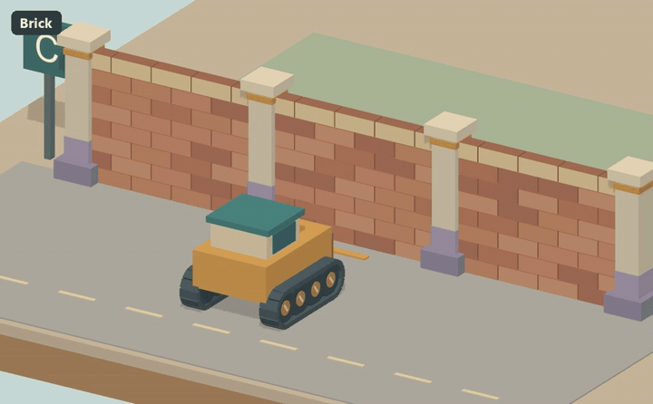
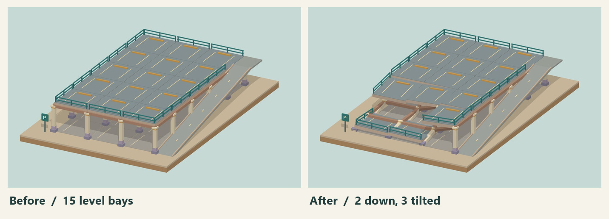

# Material Lab · 材料破坏工作台

Drive a maintenance crawler into a brick wall. Reverse, swap the same span for iron, and repeat. The bricks leave a hole. The iron bends down and stays attached to one post. Both runs below use the same vehicle, stroke and camera in the Windows player.



[Watch the 8-second comparison in full resolution (MP4)](https://github.com/li1fang/material-lab/raw/refs/heads/main/media/brick-iron.mp4) · [Try the Modular Campus sample from source](Package/README.md#modular-campus) · [Download the v0.3.0 wood, ceramic and ribbon workbenches](https://github.com/li1fang/material-lab/releases/tag/v0.3.0)

**Play Modular Campus v0.4.0.** Download the Windows ZIP, extract it and run `AI-RTS-Spectator.exe`. Press **V** for the first pass. The Unity package includes **Modular Campus** under Samples. [Windows and Unity downloads](https://github.com/li1fang/material-lab/releases/tag/v0.4.0)

### What stays connected?

**Boundary wall.** The recorded stroke dislodged 42 brick pieces from the selected span. The same stroke against iron released one end. The other end remained attached after the crawler backed away, including on replay. Try a different connection by clicking the shared corner post. In the brick test, four pieces came away on each adjoining side and the distant control span lost none. [Compare the end states](media/boundary-after.jpg) · [Original fence screenshot](media/campus-fence.jpg) · [Player measurements](evidence/modular-campus.json)

**Parking deck.** One generator assembles both the six-bay and fifteen-bay layouts. Run the same support-loss sequence on either one and watch the first slab drop, then its neighbour. On the larger deck, two slabs ended down, three tilted and ten stayed level. These are discrete game rules for connections between slabs and posts. [Watch the 4-second sequence (MP4)](https://github.com/li1fang/material-lab/raw/refs/heads/main/media/parking.mp4) · [Original parking screenshot](media/campus-parking.jpg)



**Change the layout yourself.** Edit the wall lengths, target post spacing or parking grid in the [dimension file](Package/Samples~/ModularCampus/Resources/campus-dimensions.json). A wall extended from 9 to 10.4 units acquires a 1.4-unit end span, complete with mesh and collider. A developer or coding agent can rebuild the player and repeat the same checks. Geometry is generated locally. [Build and controls](Package/README.md#modular-campus) · [Capture instructions](media/README.md)

**Related AI-RTS experiment.** A separate equipment-hall prototype used OpenAI-generated parts references and a 64-piece infill wall. In the recorded run, the character fitted through the opening at 18 missing pieces. The tracked vehicle fitted after the same opening widened to 53. Removing all the infill left the gallery level. Releasing its supports tilted and then lowered one gallery section. Those counts describe the recorded openings. [Input events and player measurements](evidence/equipment-hall-bay.json)

### Three materials you can play with in v0.3.0

Bend the green branch and watch the remaining fibres hold the tip. Chip either rim of the glazed saucer and look for the matching edge on the fragment. Tear the striped ribbon halfway, release it, then grab it again. The loose edges relax and the next pull continues from the existing tear.


### Play or build

- **Windows x64 demo** — Extract the entire Windows ZIP and run `AI-RTS-Spectator.exe`. Drag the upper right corner upward, release, and grab either loose end. Pass `--ceramic` or `--wood` to start the other benches. The in-game controls are in Chinese.
- **Unity package** — In a Universal Render Pipeline project, install `org.materiallab.destruction-0.3.0.tgz` from Package Manager, import **Material Workbench** from Samples and open `RibbonWorkbench.unity`. For wood and ceramic, open `Workbench.unity`. The runtime models live in `Package/Runtime`. The interaction, mesh presentation and shaders live in `Package/Samples~/BranchLab`.
- **From source** — On Windows with PowerShell 7, Unity Editor **7000.0.0a20** with Windows Standalone support, and Unity CLI **1.0.0-beta.13** on PATH, run the following in the extracted source directory. The host pins URP **17.7.0**. The first run needs access to the Unity packages listed in the host manifest.

```powershell
./Run.ps1 -Action Build
./Run.ps1 -Action Test
$env:MATERIAL_LAB_RIBBON_TAKE = (Resolve-Path ./examples/ribbon-two-grips.json).Path
./Run.ps1 -Action Verify
Select-String RIBBON_REPLAY_OK ./Output/Verify.log
```

The included recording came from two drags in the Windows player. The first release left 30 broken yarn bundles (22.5 cm beyond the starter cut). The second started at 30 and ended at 46 (34.5 cm). The expected log entry is `RIBBON_REPLAY_OK grips=2 broken=46`. Replay checks the material state at each release. The sample records the peak opening of each grip, so intermediate pointer motion is outside the recording.

### Scope and license

These three procedural specimens have deliberately narrow material models. The ribbon follows one longitudinal tear path, the branch uses a clamped main stem and the saucer chips at the rim. Windows desktop is the tested target. The parameters are tuned for interactive visual behaviour. The original C# code, shaders and procedural specimens use the [MIT license](Package/LICENSE.md). [Dependency and asset notices](NOTICES.md)

## 中文试玩与开发

**先看同一辆车退回来以后。** 同一段围墙、同一条车路，换一种材料，留下的损伤就不一样。砖墙掉了 42 块，缺口留在受压的一跨。换成铁栅栏，一端落下，另一端还牵在柱子上。换个位置点共用角柱，两侧砖墙各掉 4 块，远处的一跨保持完整。[砖墙与铁栅栏实录](https://github.com/li1fang/material-lab/raw/refs/heads/main/media/brick-iron.mp4) · [退车后的并排近照](media/boundary-after.jpg)

**停车楼把支撑关系单独展现出来。** 把 2×3 开间扩成 3×5，用同一组输入，两次都能看到一块楼面先掉，邻跨随后失去支撑。大停车楼最后有两块落下、三块倾斜、十块水平。你可以倒回第一块下落前，亲手重放。楼面的失撑和挂靠由离散连接规则驱动。[停车楼实录](https://github.com/li1fang/material-lab/raw/refs/heads/main/media/parking.mp4) · [同机位前后图](media/parking-before-after.jpg) · [实测数据](evidence/modular-campus.json)

**下载校园试玩 v0.4.0。** 完整解压 Windows ZIP，运行 `AI-RTS-Spectator.exe`，按 **V** 就能压第一面墙。Unity 用户可安装同版 TGZ，在 Samples 中导入 Modular Campus。[Windows 试玩与 Unity 包](https://github.com/li1fang/material-lab/releases/tag/v0.4.0)

**从源码试玩校园。** 导入 Modular Campus，打开 `Campus.unity`。选中一跨按 V，等履带车退回后换铁栅栏，再按一次 V。在停车楼选择「运行连续失撑对照」可以复现视频。围墙长度、柱距、车库行列共用一份可编辑配置，开发者或 AI 都可以改尺寸、构建、重放。现成的 v0.3.0 Windows 下载和 Unity 包包含鲜枝、陶碟、布带三个工作台。[校园构建与操作](Package/README.md#modular-campus) · [v0.3.0 下载](https://github.com/li1fang/material-lab/releases/tag/v0.3.0)

独立的 AI-RTS 器材库还验证了洞口形状对通行的影响。一次记录中，同一个洞从脱落 18 块扩大到 53 块，先能过人，再能过车。整面填充墙卸掉，二层外廊仍然水平。这样的记录可以用来检查游戏里通行和支撑各自发生在何时。[器材库实测记录](evidence/equipment-hall-bay.json)

v0.3 从条纹织带开始。双击 [Open-Ribbon.cmd](Open-Ribbon.cmd)，抓住右上角向上拖，或抓右下角向下拖。松手后可以从同一端再抓，比较两次之间的裂口长度。「换新布带」开始新一轮。最新操作写到 `Application.persistentDataPath/ribbon-take.json`，也可以传入 `--ribbon-log <绝对路径>`。将环境变量 `MATERIAL_LAB_RIBBON_TAKE` 指向记录，再运行 Verify，即可核对每一次松手时断开的纱束数。

双击 `Open-Ceramic.cmd` 进入 v0.2 陶碟台。先在同一侧点「轻碰」和「重击」，点「反面看」观察釉层下露出的陶胎。点「换新碟」再换到右缘可以比较缺口的位置。「落枝击碟」和「把碟移开」从同一根完好的木枝开始。随时可切到「木枝台」亲手压折。

用 Unity 7000.0.0a20 和 Unity CLI 1.0.0-beta.13 构建。运行时与可导入样例在 [Package](Package/README.md)。在此目录用 PowerShell 7 执行：

```powershell
./Run.ps1 -Action Build
./Run.ps1 -Action Test
./Run.ps1 -Action Verify
```

输出默认在 `Output`。可用 `-Output` 指定独立目录，三步使用同一目录；Build 输出 `Windows/AI-RTS-Spectator.exe`，Test 输出 NUnit XML，Verify 输出 `simulation.json`。Verify 默认跑向下深压，可设置环境变量 `MATERIAL_LAB_TRIAL` 指向自定义案例文件。要在编辑器中操作，先执行 Prepare，再用 `unity open` 打开生成的 ExampleProject，一次只运行一个该工程实例。

播放器参数 `--ceramic-proof <空目录>` 录制轻碰左缘、重击左缘、重击右缘、落枝击碟、移开陶碟五案。每案包含播放器输出的逐帧 JPEG 和接触记录 `result.json`。设置 `MATERIAL_LAB_CERAMIC_PROOF` 为五案目录的绝对路径，再运行 Verify，可在批处理中核对实际接触、部位、时序，并从冲量重算断边 ID。一次重放五组需要先跑完一次取帧。

以 `--wood` 启动可直接进入鲜枝台。`--branch-proof <空目录>` 采集浅压、向下深压、向上深压和首裂即脱落的逐帧 JPEG 和 `result.json`，结束时自动关闭。附加 `--branch-trial <JSON 文件>` 可只取证一个案例。单独使用 `--branch-trial` 可在窗口内播放该文件。`--branch-benchmark <输出 JSON 路径>` 在一次预热后播放三次，记录无取帧时的 P95 和断裂时的峰值。
