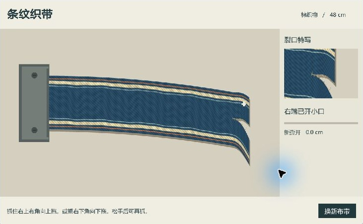

# Material Lab · 材料破坏工作台

Grab a striped ribbon, tear it halfway, let go, then pick it up again. The loose edges relax and the tear stays where you left it. The other two specimens let you bend a green branch until the fibres separate and chip a glazed saucer by dropping a weight on either rim.



### Play or build

- **Windows x64 demo** — Extract the entire Windows ZIP and run `AI-RTS-Spectator.exe`. Drag the upper right corner upward, release, and grab either loose end. Pass `--ceramic` or `--wood` to start the other benches. The in-game controls are in Chinese.
- **Unity package** — In a Universal Render Pipeline project, install `org.materiallab.destruction-0.3.0.tgz` from Package Manager, import **Material Workbench** from Samples and open `RibbonWorkbench.unity`. For wood and ceramic, open `Workbench.unity`. The runtime models live in `Package/Runtime`. The interaction, mesh presentation and shaders live in `Package/Samples~/BranchLab`.
- **From source** — On Windows with PowerShell 7, Unity Editor **7000.0.0a20** with Windows Standalone support, and Unity CLI **1.0.0-beta.13** on PATH, run the following in the extracted source directory. The host pins URP **17.7.0**. The first run needs access to the Unity packages listed in the host manifest.

```powershell
./Run.ps1 -Action Build
./Run.ps1 -Action Test
$env:MATERIAL_LAB_RIBBON_TAKE = (Resolve-Path ./examples/ribbon-two-grips.json).Path
./Run.ps1 -Action Verify
Select-String RIBBON_REPLAY_OK ./Output/Verify.log
```

The included recording came from two drags in the Windows player. The first release left 30 broken yarn bundles (22.5 cm beyond the starter cut). The second started at 30 and ended at 46 (34.5 cm). The expected log entry is `RIBBON_REPLAY_OK grips=2 broken=46`. Replay checks the material state at each release. The sample records the peak opening of each grip, so intermediate pointer motion is outside the recording.

### Scope and license

These three procedural specimens have deliberately narrow material models. The ribbon follows one longitudinal tear path, the branch uses a clamped main stem and the saucer chips at the rim. Windows desktop is the tested target. The parameters are tuned for interactive visual behaviour. The original C# code, shaders and procedural specimens use the [MIT license](Package/LICENSE.md). [Dependency and asset notices](NOTICES.md)

## 中文试玩与开发

v0.3 从条纹织带开始。双击 [Open-Ribbon.cmd](Open-Ribbon.cmd)，抓住右上角向上拖，或抓右下角向下拖。松手后可以从同一端再抓，比较两次之间的裂口长度。「换新布带」开始新一轮。最新操作写到 `Application.persistentDataPath/ribbon-take.json`，也可以传入 `--ribbon-log <绝对路径>`。将环境变量 `MATERIAL_LAB_RIBBON_TAKE` 指向记录，再运行 Verify，即可核对每一次松手时断开的纱束数。

双击 `Open-Ceramic.cmd` 进入 v0.2 陶碟台。先在同一侧点「轻碰」和「重击」，点「反面看」观察釉层下露出的陶胎。点「换新碟」再换到右缘可以比较缺口的位置。「落枝击碟」和「把碟移开」从同一根完好的木枝开始。随时可切到「木枝台」亲手压折。

用 Unity 7000.0.0a20 和 Unity CLI 1.0.0-beta.13 构建。运行时与可导入样例在 [Package](Package/README.md)。在此目录用 PowerShell 7 执行：

```powershell
./Run.ps1 -Action Build
./Run.ps1 -Action Test
./Run.ps1 -Action Verify
```

输出默认在 `Output`。可用 `-Output` 指定独立目录，三步使用同一目录；Build 输出 `Windows/AI-RTS-Spectator.exe`，Test 输出 NUnit XML，Verify 输出 `simulation.json`。Verify 默认跑向下深压，可设置环境变量 `MATERIAL_LAB_TRIAL` 指向自定义案例文件。要在编辑器中操作，先执行 Prepare，再用 `unity open` 打开生成的 ExampleProject，一次只运行一个该工程实例。

播放器参数 `--ceramic-proof <空目录>` 录制轻碰左缘、重击左缘、重击右缘、落枝击碟、移开陶碟五案。每案包含播放器输出的逐帧 JPEG 和接触记录 `result.json`。设置 `MATERIAL_LAB_CERAMIC_PROOF` 为五案目录的绝对路径，再运行 Verify，可在批处理中核对实际接触、部位、时序，并从冲量重算断边 ID。一次重放五组需要先跑完一次取帧。

以 `--wood` 启动可直接进入鲜枝台。`--branch-proof <空目录>` 采集浅压、向下深压、向上深压和首裂即脱落的逐帧 JPEG 和 `result.json`，结束时自动关闭。附加 `--branch-trial <JSON 文件>` 可只取证一个案例。单独使用 `--branch-trial` 可在窗口内播放该文件。`--branch-benchmark <输出 JSON 路径>` 在一次预热后播放三次，记录无取帧时的 P95 和断裂时的峰值。
